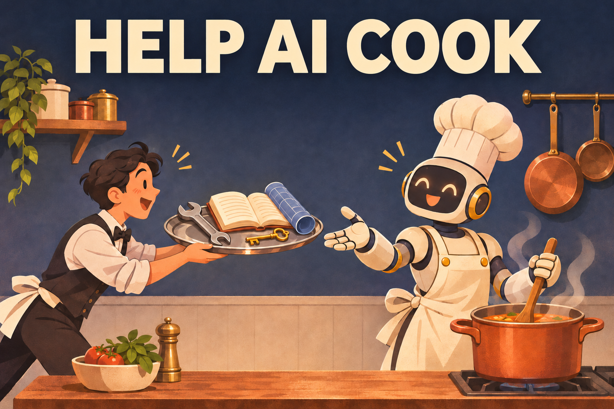

# Help AI Cook



An [Agent Skill](https://agentskills.io) for Claude Code, Codex, Cursor, Gemini CLI, and other AI coding agents that read the same format. It makes the agent ask for the tools, context, and access it is missing before it starts a task, instead of guessing.

## The idea

An agent produces a result from three things: what it knows, what it can do, and what it can check. If one of them is missing, telling the agent to try harder does not help. It will start anyway, take whatever route its current tools allow, fill the holes with guesses, and hand back something that looks finished.

Often you could have closed the gap in a few minutes by installing a tool, sharing a reference, or answering one question. You just did not know the gap was there.

This skill makes the agent find that gap and show it to you before any work begins. You decide what is worth your time, and the agent works with what you gave it.

## What it does

Before a task, the agent:

1. Pins down the goal and the quality bar.
2. Works out how a skilled person would produce the result, and lists the realistic routes.
3. Checks what it actually has: installed tools, project contents, docs.
4. Lists the gaps: knowledge, tools, access, material, and things only you can check.
5. Reports on one screen what you get today and what each ask would unlock.
6. Does the work, and names every assumption the result still rests on.

## Example

You ask for a sword-attack animation in a Unity project. Instead of writing an animation file by hand, the agent replies along these lines:

```
Goal: a sword-attack animation for the player, good enough for a playable prototype.

What I don't know
A. Is the character a 3D rig or a 2D sprite? — where I looked: Assets/, no character found
   · if unanswered I'll assume a 3D humanoid

With what we have now: I write the animation file by hand → stiff motion, and I cannot watch it play.

What would make it better
1. Leave the Unity Editor open with its command-line bridge enabled — unlocks building the clip
   in the editor and capturing frames to check it · costs you about 5 minutes
2. Install Blender — unlocks animating on the real skeleton · costs you about 10 minutes
3. Download a ready-made attack clip from an animation library — unlocks the best motion,
   which I retarget · costs you about 10 minutes and your own account

I'd do: 1 and 3.

Answer the letters, reply with the numbers you'll do, or say "go".
```

## Install

The skill is a single file, [skills/help-ai-cook/SKILL.md](skills/help-ai-cook/SKILL.md), in the [Agent Skills](https://agentskills.io) format, which many coding agents read.

With the [skills CLI](https://github.com/vercel-labs/skills), which places it in the right folder for your agent:

```bash
npx skills add ezgameworkplace/help-ai-cook
```

Or by hand: copy the `skills/help-ai-cook` folder into your agent's skills directory. For Claude Code that is `~/.claude/skills/`. Several other agents read a shared `.agents/skills/` folder. Check your agent's documentation for its path.

If your agent does not support skills, paste the body of `SKILL.md` into its custom instructions.

## Use

Ask the agent what it needs before a task, for example "what do you need from me before you start?", or name the skill directly. Agents that load skills automatically should also pick it up on their own before work that depends on tools or materials they do not have.

## License

[MIT](LICENSE)
